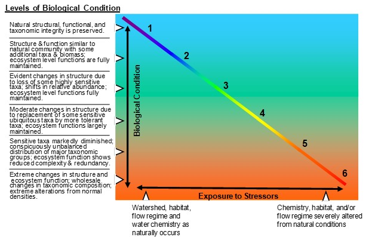

```{r setup, include=FALSE}
knitr::opts_chunk$set(echo = FALSE
                      , results = 'asis'
                      , warning = FALSE
                      , message = FALSE)
```

# About

This website calculates Biological Condition Gradient (BCG) scores for
macroinvertebrate and fish assemblages in Great Plains wadeable streams in Iowa,
Missouri, Nebraska, Kansas and Oklahoma.

For those who prefer to work with R, the functions are carried out by the 
<a href="https://CRAN.R-project.org/package=BCGcalc" target="_blank">BCGcalc</a>
and 
<a href="https://CRAN.R-project.org/package=BioMonTools " target="_blank">BioMonTools</a>
R packages, which are available on CRAN and GitHub and were developed by Erik W.
Leppo from Tetra Tech (Erik.Leppo@tetratech.com). If using the R code instead of
the Shiny app, you won’t need internet access if you have R installed on your
computer and have downloaded all the necessary packages.

# Methods Matter!

The BCG models were calibrated with data collected using specific field and
laboratory protocols. When applying the models, make sure you are applying them 
to the correct type of data. For example, the Kansas macroinvertebrate model
should only be applied to data collected and processed with Kansas Department of
Health and Environment (KDHE) methods and the Missouri model should only be
applied to data collected and processed with Missouri Department of Natural
Resources (MO DNR) methods.

# What is the Biological Condition Gradient (BCG)?

{width="75%"}

The Biological Condition Gradient (BCG) model is a conceptual model describing 
how ecological attributes change in response to increasing levels of 
human-caused stress. The BCG has a universal scoring scale with six levels of
biological condition, ranging from observable biological conditions found at no
or low levels of stressors (level 1) to those found at high levels of stressors
(level 6). Narratives for each BCG level are shown in the figure above. The 
model is calibrated using expert elicitation. Biologists work collaboratively to
reach consensus on assigning biological samples to BCG levels. Their ratings and
rationale are then used to calibrate a quantitative model. Model performance is
judged based on how well the model matches the expert BCG level assignments.

# Additional resources

Synopsis: The Biological Condition Gradient (BCG) - A Model for Interpreting Anthropogenic Stress on the Aquatic Environment 
[<a href="https://www.epa.gov/sites/default/files/2021-03/documents/bcg-flyer-2021.pdf" target="_blank">Link</a>]

A Practitioner’s Guide to the Biological Condition Gradient: A Framework to Describe Incremental Change in Aquatic Ecosystems 
[<a href="https://www.epa.gov/sites/default/files/2016-02/documents/bcg-practioners-guide-report.pdf" target="_blank">Link</a>]

------------------------------------------------------------------------

*Last updated 2026-11-05*
